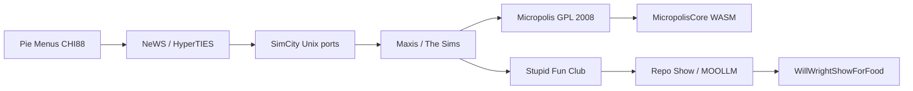

# Don Hopkins

*Sniff:* [`GLANCE.md`](GLANCE.md) · [`CARD.md`](CARD.md) · [`CARD.yml`](CARD.yml) · [`browse-the-bouquet.yml`](browse-the-bouquet.yml)

👤 **Don Hopkins**, user-interface designer and programmer: pie menus, The Sims,
Micropolis, Repo Show host. The facts live in YAML under
[`career/`](career/INDEX.yml); this README is the narrative, showing how each
project led to the next.

**Want to talk?** [Open an issue](https://github.com/SimHacker/WillWrightShowForFood/issues)
or submit a PR. **Photos:** [`media.md`](media.md) · **Books:** [`books/`](books/README.md) ([Methodology of Window Management](books/methodology-of-window-management.md))

---

## The thread

Don started by hand-writing Forth on a 6502, then got onto the ARPANET and into Zork, and
began designing pie menus for modeled worlds (pie menus go back to PIXIE in 1969; see the
planned Heinz U. Lemke episode). PostScript gave those menus a language, and NeWS let
clients send code to the window server. HyperLook SimCity, inspired by HyperCard, rebuilt
the simulation with integrated scalable PostScript visualizations, a UI editor, and graphics
editors, and let people paint and play across the network. At Maxis, the
dollhouse became The Sims, and Transmogrifier let players make their own objects. The OLPC
project led to the source release as Micropolis, and the same imaging model carries forward
through Cairo, Canvas and WebGPU. Kaleida ScriptX was an object-oriented multimedia Lisp
machine (*so much fun*), and DreamScape was an early memory palace. At Stupid Fun Club, the
robots asked people for empathy. Constraint solvers (Garnet → Laszlo → Svelte)
have kept declarative UI working across decades. Now the filesystem itself is the game
board: `import self from self`, MOOLLM, Repo Show. Machine-readable version:
[`CARD.yml`](CARD.yml) → `connections-index`.

Each row below is a short description (about 24 words). The "Opens →" column gives the next file in reading order.

---

## I — Identity

| File | What it is | Opens → |
|------|------------|---------|
| [`about-host.md`](about-host.md) | Resume as a repo room: a one-screen map of the career. | [`media.md`](media.md) |
| [`hire-me.md`](hire-me.md) | Available for hire (2026): résumé page; references: Will Wright, Henry Minsky. | [`career/work-history.yml`](career/work-history.yml) |
| [`media.md`](media.md) | Photos and screenshots: Queen's Day LISP shirt, Sims era, Micropolis demos. | [`career/lineage.yml`](career/lineage.yml) |
| [`GLANCE.md`](GLANCE.md) · [`CARD.md`](CARD.md) · [`CARD.yml`](CARD.yml) · [`CHARACTER.yml`](CHARACTER.yml) | Sniff card, trading card, machine schema, host registry: the same profile at four levels of detail. | [`pie-menus-chi-88-and-beyond.md`](pie-menus-chi-88-and-beyond.md) |
| [`browse-the-bouquet.yml`](browse-the-bouquet.yml) | Machine index of topic filenames (the filenames describe their contents); complements the reading order here. | Cluster II |
| [`sync-sources.yml`](sync-sources.yml) | Upstream sync map and dedupe rules. | [`career/`](career/INDEX.yml) |

---

## II — Gestural verbs (1988 · HCIL → the verb-picker)

*Pie menus and Fitts's law: you select by direction, not by distance.*

| File | What it is | Opens → |
|------|------------|---------|
| [`pie-menus-chi-88-and-beyond.md`](pie-menus-chi-88-and-beyond.md) | From PIXIE (1969) to the CHI'88 study; pie menus as the gestural verb-picker for SimCity, The Sims, MOOLLM. | [`axis-of-eval-send-code-not-commands.md`](axis-of-eval-send-code-not-commands.md) |
| [`queer-oui-for-the-straight-gui.md`](queer-oui-for-the-straight-gui.md) | *Queer Oui* / *Put the SaS into SaaS*: a clinic for rescuing designs: keep the soul and skin, replace the hands; whiteboard with [Edd](../edd-coates/). | [`jojo-on-ui.md`](jojo-on-ui.md) |
| [`jojo-on-ui.md`](jojo-on-ui.md) | Joseph Francis's UI satire (UNIX-HATERS mirror): POSEUR / XYmorph / boraX / XBorges; companion to Queer Oui. | [`axis-of-eval-send-code-not-commands.md`](axis-of-eval-send-code-not-commands.md) |
| [`portrayal/presentations.yml`](portrayal/presentations.yml) | Verified papers and talks: CHI'88 links, BayCHI, DreamScape WWDC; sources for the claims in this section. | [`axis-of-eval-send-code-not-commands.md`](axis-of-eval-send-code-not-commands.md) |

---

## III — Send code, not commands (1988–1995 · NeWS → PostScript motherboard)

*NeWS: a window server programmed in PostScript, so clients send code rather than X11-style command streams.*

| File | What it is | Opens → |
|------|------------|---------|
| [`axis-of-eval-send-code-not-commands.md`](axis-of-eval-send-code-not-commands.md) | NeWS: the *X-Windows Disaster* critique, Owen Densmore's OOPS, and the send-code idea the web later adopted. | [`hyperlook-news-postscript-simcity.md`](hyperlook-news-postscript-simcity.md) |
| [`hyperlook-news-postscript-simcity.md`](hyperlook-news-postscript-simcity.md) | HyperLook SimCity, inspired by HyperCard: integrated PostScript visualization, UI editor, graphics editors; built at DUX. | [`porter-duff-postscript-to-webgpu.md`](porter-duff-postscript-to-webgpu.md) |
| [`porter-duff-postscript-to-webgpu.md`](porter-duff-postscript-to-webgpu.md) | The Porter/Duff imaging model, from stencil-paint in the window server through Cairo and Canvas 2D to nested WebGPU compositing. | [`kaleida-scriptx-dreamscape-multimedia-lisp-machine.md`](kaleida-scriptx-dreamscape-multimedia-lisp-machine.md) |
| [`kaleida-scriptx-dreamscape-multimedia-lisp-machine.md`](kaleida-scriptx-dreamscape-multimedia-lisp-machine.md) | Kaleida ScriptX, an OO multimedia Lisp machine; the DreamScape mirror world; WWDC 1995; live authoring. | [`interval-research-pluggers-and-mediaflow.md`](interval-research-pluggers-and-mediaflow.md) |

---

## IV — Interval Research (1992–1999)

*Paul Allen's lab studied how people use media: Pluggers, MediaFlow, Camelot.*

| File | What it is | Opens → |
|------|------------|---------|
| [`interval-research-pluggers-and-mediaflow.md`](interval-research-pluggers-and-mediaflow.md) | Interval Camelot: MediaFlow, Bounce, Director plug-ins, Tom Ngo's ECG; the pie menus talk Don gave before he was hired. | [`tom-ngo-embedded-constraint-graphics-at-interval.md`](tom-ngo-embedded-constraint-graphics-at-interval.md) |
| [`tom-ngo-embedded-constraint-graphics-at-interval.md`](tom-ngo-embedded-constraint-graphics-at-interval.md) | ECG at Interval: simplicial complexes, Mouther, patent US5933150; Don's 2016 G9.js HN comment. | [`breakfast-simplex-barycentric-direct-manipulation.md`](breakfast-simplex-barycentric-direct-manipulation.md) |
| [`breakfast-simplex-barycentric-direct-manipulation.md`](breakfast-simplex-barycentric-direct-manipulation.md) | Breakfast simplex: Dark Breakfast, barycentric coordinates and pie menus; 2025 HN essay. | [`mediaflow-design-comments.md`](mediaflow-design-comments.md) |
| [`mediaflow-design-comments.md`](mediaflow-design-comments.md) | MediaFlow Design Comments: full Interval essay; Bongo dictionaries → [IFC vs Bongo](ifc-vs-bongo-comparison.md). | [`ifc-vs-bongo-comparison.md`](ifc-vs-bongo-comparison.md) |
| [`ifc-vs-bongo-comparison.md`](ifc-vs-bongo-comparison.md) | IFC vs Bongo: Netscape vs Marimba; `getProperties` property sheets; Arthur van Hoff; the connection to yaml-jazz. | [`history/interval-research.yml`](history/interval-research.yml) |
| [`history/interval-research.yml`](history/interval-research.yml) | The same Interval material as machine-readable YAML, for searching across repos. | [`history/README.md`](history/README.md) |
| [`history/README.md`](history/README.md) | History index: public-safe summaries, one per period; no raw correspondence. | Cluster V |

---

## V — SimCity, The Sims, and community tools (1991–2007)

*SimCity, The Sims, and the tools that let players make their own content.*

| File | What it is | Opens → |
|------|------------|---------|
| [`career/simcity-lineage.yml`](career/simcity-lineage.yml) | SimCityNet → OLPC → WASM timeline; the YAML timeline the SimCity topic files link from. | [`open-sourcing-simcity-for-olpc.md`](open-sourcing-simcity-for-olpc.md) |
| [`open-sourcing-simcity-for-olpc.md`](open-sourcing-simcity-for-olpc.md) | December 2006 pitch letter to Rod Humble, and the email that followed, which cleared SimCity for OLPC and the GPL Micropolis release. | [`career/contracts/README.md`](career/contracts/README.md) |
| [`career/contracts/README.md`](career/contracts/README.md) | DUX ↔ Maxis ↔ EA ↔ OLPC contracts that made the open-source release legally possible. | [`../will-wright/primary-sources-evidence-room.md`](../will-wright/primary-sources-evidence-room.md) |
| [`../will-wright/primary-sources-evidence-room.md`](../will-wright/primary-sources-evidence-room.md) | Map of Will Wright sources: the Winograd talk, Motive.c, Transmogrifier, the full OLPC email thread. | [`the-sims-transmogrifier-mod-tools.md`](the-sims-transmogrifier-mod-tools.md) |
| [`the-sims-transmogrifier-mod-tools.md`](the-sims-transmogrifier-mod-tools.md) | Maxis modding tools: Transmogrifier, RugOMatic, SimShow, VitaBoy; objects that carry their own behavior, for community authors. | [`olpc-micropolis-python-pygtk.md`](olpc-micropolis-python-pygtk.md) |
| [`olpc-micropolis-python-pygtk.md`](olpc-micropolis-python-pygtk.md) | Python Sugar adaptor: a PyGTK, Cairo and Pango shell wrapping Tcl/Tk SimCity for the XO laptop. | [`teaching-complicated-systems-without-a-manual.md`](teaching-complicated-systems-without-a-manual.md) |
| [`teaching-complicated-systems-without-a-manual.md`](teaching-complicated-systems-without-a-manual.md) | Public essay (Aug 2026) answering Tade Mehl's emailed questions on teachable humanoid UI; SimCity → PBD → MOOLLM. | [`canon-cant-and-teachable-worlds.md`](canon-cant-and-teachable-worlds.md) |
| [`canon-cant-and-teachable-worlds.md`](canon-cant-and-teachable-worlds.md) | Notes on Nick Tau's Canon MUD (Aug 2026): governance by topology, consent by state ontology, rate-limited LLM tutoring, language design that is deliberately hard to learn. | [`writing/INDEX.yml`](writing/INDEX.yml) |
| [`writing/README.md`](writing/README.md) · [`writing/INDEX.yml`](writing/INDEX.yml) | Essay and primary-source index: Medium recreations, Will Wright source groups, donhopkins.com cross-links. | Cluster VI |

---

## VI — Stupid Fun Club robots (2009–2014)

*Will Wright's lab studied how people treat machines: a waiter robot, broken robots, one-minute films.*

| File | What it is | Opens → |
|------|------------|---------|
| [`career/stupid-fun-club.yml`](career/stupid-fun-club.yml) | SFC timeline in YAML: Slats, Dents, MediaGraph, networked AR; the work behind the robot films. | [`stupid-fun-club-empathy-and-servitude.md`](stupid-fun-club-empathy-and-servitude.md) |
| [`stupid-fun-club-empathy-and-servitude.md`](stupid-fun-club-empathy-and-servitude.md) | *Servitude* and *Empathy*, one-minute movies about reviews, breakdowns, and performed feeling. | [`talks/empathy-and-servitude.yml`](talks/empathy-and-servitude.yml) |
| [`talks/empathy-and-servitude.yml`](talks/empathy-and-servitude.yml) | Talk outline for the Empathy/Servitude show; links to Will Wright sources and to Slats. | [`../slats/`](../robots/slats/README.md) |
| [`../slats/`](../robots/slats/README.md) | Slats, the waiter robot Don programmed; appears in this repo as a drag-race judge and show sidekick. | Cluster VII |

---

## VII — Constraint solvers and platforms (1992–2020s)

*Each GUI generation has had its own constraint system, keeping relationships in data instead of scattered through code.*

| File | What it is | Opens → |
|------|------------|---------|
| [`garnet-to-svelte-constraint-ui-lineage.md`](garnet-to-svelte-constraint-ui-lineage.md) | Garnet → OpenLaszlo → Svelte: from Brad Myers's KR constraints to `$derived`; how this shaped MOOLLM's YAML. | [`nutritionquest-turbogears-genshi-alive-pd.md`](nutritionquest-turbogears-genshi-alive-pd.md) |
| [`nutritionquest-turbogears-genshi-alive-pd.md`](nutritionquest-turbogears-genshi-alive-pd.md) | Ten years of TurboGears at NutritionQuest: from Zope to SQLObject and Genshi; still running in production. | [`yoot-tower-open-source-and-alan-kay-interview.md`](yoot-tower-open-source-and-alan-kay-interview.md) |
| [`yoot-tower-open-source-and-alan-kay-interview.md`](yoot-tower-open-source-and-alan-kay-interview.md) | Yoot Tower open-source work and the 1993 Alan Kay interview: preserving the tower game, and constructionist microworld history. | Cluster VIII |

---

## VIII — Micropolis today (2006–now)

*Since the GPL release, development has moved to the browser.*

| File | What it is | Opens → |
|------|------------|---------|
| [`micropoliscore-design-docs-packages-code-content.md`](micropoliscore-design-docs-packages-code-content.md) | MicropolisCore map: design docs, packages, WASM engine, PieCraft, content pipelines; the implementation repo. | [`career/project-threads.yml`](career/project-threads.yml) |
| [`career/project-threads.yml`](career/project-threads.yml) | Diagram of how the projects connect: pie menus through The Sims, Micropolis, Repo Show. | Cluster IX |

---

## IX — import self from self (now · MOOLLM, Repo Show, guests)

*Directories as rooms, skills that inherit like Self objects, GitHub as the stage.*

| File | What it is | Opens → |
|------|------------|---------|
| [`import-self-from-self.md`](import-self-from-self.md) | MOOLLM constitution: `# import self from self`; directories as rooms, skills as prototypes, k-line naming as inheritance. | [`self-interest-narcissas-mirror-david-ungar.md`](self-interest-narcissas-mirror-david-ungar.md) |
| [`self-interest-narcissas-mirror-david-ungar.md`](self-interest-narcissas-mirror-david-ungar.md) | Proposed Repo Show with David Ungar: Self puns, *Narcissa's Mirror*, and the representation-ethics rules for portraying him. | [`moollm-microworld-os-talk.md`](moollm-microworld-os-talk.md) |
| [`moollm-microworld-os-talk.md`](moollm-microworld-os-talk.md) | Main talk, *The Sims for your filesystem*: the microworld OS idea in short form. | [`talks/moollm-microworld-os.yml`](talks/moollm-microworld-os.yml) |
| [`talks/moollm-microworld-os.yml`](talks/moollm-microworld-os.yml) | Talk outline in YAML: slide order, demos, links to the lineage files and the MOOLLM repo; safe to export from Don's private archive. | [`repo-show-host-facet.md`](repo-show-host-facet.md) |
| [`repo-show-host-facet.md`](repo-show-host-facet.md) | Don as Repo Show host: Repo Show, RTFR, GitHub as MMORPG; designing in public. | [`ideas.md`](ideas.md) |
| [`ideas.md`](ideas.md) | Guests Don hopes to invite and show ideas: Will, Ungar, Bender, Adams, Yoot; episodes Don would like to build on air. | [`talks/INDEX.yml`](talks/INDEX.yml) |
| [`talks/README.md`](talks/README.md) · [`talks/INDEX.yml`](talks/INDEX.yml) | Talk index: main talks, verified past talks, ideas to develop; see also portrayal presentations. | [`career/lineage.yml`](career/lineage.yml) |

---

## X — YAML records and portrayal

*The markdown above is the narrative; the YAML holds the facts and sources.*

| File | What it is | Opens → |
|------|------------|---------|
| [`career/INDEX.yml`](career/INDEX.yml) | Career index: entry point for the YAML files below, easy to browse on GitHub. | [`career/lineage.yml`](career/lineage.yml) |
| [`career/lineage.yml`](career/lineage.yml) | Lineage of ideas: MUD1, LambdaMOO, DreamScape, SimCity, The Sims, iLoci, LayAR, MOOLLM. | [`career/range.yml`](career/range.yml) |
| [`career/range.yml`](career/range.yml) | Technical range: 6502 Forth through Rust/WASM/LLM; robots, computer vision, DevOps. | [`career/work-history.yml`](career/work-history.yml) |
| [`career/work-history.yml`](career/work-history.yml) | Condensed employment timeline: public-safe dates and roles; see the contracts for the SimCity open-source details. | [`career/on-stream.yml`](career/on-stream.yml) |
| [`career/on-stream.yml`](career/on-stream.yml) | Don on stream vs. the Don Philahue announcer character: which one speaks in docs and which on air. | [`../don-philahue/`](../don-philahue/README.md) |
| [`career/README.md`](career/README.md) | Career folder readme: points to INDEX and contracts. | [`career/contracts/transmogrifier-distribution-license-notes.md`](career/contracts/transmogrifier-distribution-license-notes.md) |
| [`career/contracts/transmogrifier-distribution-license-notes.md`](career/contracts/transmogrifier-distribution-license-notes.md) | Transmogrifier EA distribution terms: legal notes drawn from the renovation plan and Wayback Machine copies. | [`portrayal/voice.yml`](portrayal/voice.yml) |
| [`portrayal/README.md`](portrayal/README.md) | Portrayal folder: voice, heroes, presentations; how Don writes and whom he credits. | [`portrayal/voice.yml`](portrayal/voice.yml) |
| [`portrayal/voice.yml`](portrayal/voice.yml) | Writing style and frobisms, synced from moollm adventure-4. | [`portrayal/heroes.yml`](portrayal/heroes.yml) |
| [`portrayal/heroes.yml`](portrayal/heroes.yml) | Mentors credited: Shneiderman, Weiser, Will Wright, Alan Kay, and the ideas Don took from them. | Cluster I (re-read any room) |

---

## Now

Porting Micropolis to the web with WASM and SvelteKit. Running Repo Show: live
conversations held on a GitHub repo that follow through to working code. Building the
Sims content tools in the browser (Transmogrifier, RugOMatic, WigFabrik lineage).

## Threads at a glance

## On stream vs on stage

| Facet | Who |
|-------|-----|
| Don himself: interviews, implementation, chat | This character ([`career/on-stream.yml`](career/on-stream.yml)) |
| AI announcer character, Q&A host | [Don Philahue](../don-philahue/README.md) |

## Deeper

- [donhopkins.com](https://donhopkins.com)
- [SimHacker/MicropolisCore](https://github.com/SimHacker/MicropolisCore)
- [SimHacker/moollm](https://github.com/SimHacker/moollm)
- [moollm adventure-4 Don Hopkins](https://github.com/SimHacker/moollm/tree/main/examples/adventure-4/characters/real-people/don-hopkins)

↑ [`../README.md`](../README.md) · [`CARD.yml`](CARD.yml) · [`../../process/cross-links.yml`](../../process/cross-links.yml)

🐒✋ *Shelved all over Palmhoo, but especially:
[Generative Art & Music](../../palmhoo/generative-art-and-music/README.md) (the granular CA
synth, net jamming), [Concurrency & Messaging](../../palmhoo/concurrency-and-messaging/README.md)
(streams of streams; also the HN quip "just set the pile of C++ manuals on fire — no gophers
needed"), and [Packages](../../palmhoo/packages/README.md) (the uplift doctrine is his cauldron
with the lid on).*
