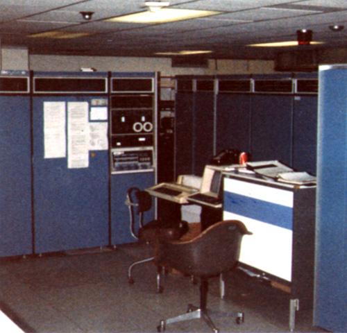
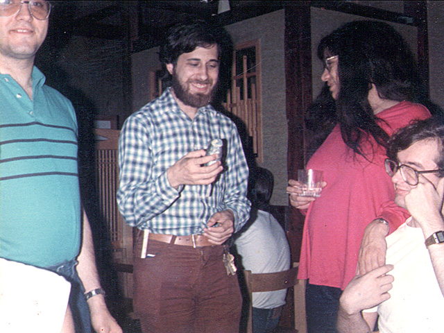

# MIT AI Lab Tourist Policy

An accessible copy of Don Hopkins's Medium article
[MIT AI Lab Tourist Policy](https://donhopkins.medium.com/mit-ai-lab-tourist-policy-f73b77075631)
(15 May 2018), taken from the
[Wayback Machine copy of 20 September 2024](http://web.archive.org/web/20240920044702/https://donhopkins.medium.com/mit-ai-lab-tourist-policy-f73b77075631)
because Medium refuses scripted downloads. The article has two parts: an
excerpt from Sam Williams's biography of Richard Stallman about the
"tourists" who used MIT's computers over the ARPANET, Don among them, and
the full text of the lab's written tourist policy. The policy text here
follows Don's older plain copy,
[tourist-policy.html](http://www.art.net/~hopkins/Don/text/tourist-policy.html)
on art.net, which keeps its numbered rules.

Don has told this story many times on Hacker News; those comments are
collected in [Grateful tourist: Don's Hacker News posts about the MIT AI Lab](mit-ai-lab-grateful-tourist-hn.md).
The door the tourists knocked on, and the PDP-11 bit that opened it, are in
[Call me an elevator](../kent-pitman/elevator-and-door.md).

*MIT-MC PDP-10 at the MIT AI Lab.*

## Context: Free as in Freedom, chapter 7

From Sam Williams,
[*Free as in Freedom: Richard Stallman's Crusade for Free Software*](https://www.oreilly.com/openbook/freedom/ch07.html)
(O'Reilly, March 2002), chapter 7. The bracketed correction is Don's: he
was a high school student in Maryland at the time, not a California
programmer.

> Cadging passwords and deliberately crashing the system in order to glean
> evidence from the resulting wreckage, Stallman successfully foiled the
> system administrators' attempt to assert control. After one foiled "coup
> d'etat," Stallman issued an alert to the entire AI staff.
>
> "There has been another attempt to seize power," Stallman wrote. "So far,
> the aristocratic forces have been defeated." To protect his identity,
> Stallman signed the message "Radio Free OZ."
>
> The disguise was a thin one at best. By 1982, Stallman's aversion to
> passwords and secrecy had become so well known that users outside the AI
> Laboratory were using his account as a stepping stone to the ARPAnet, the
> research-funded computer network that would serve as a foundation for
> today's Internet. One such "tourist" during the early 1980s was Don
> Hopkins, a California [Maryland at the time, actually] programmer who
> learned through the hacking grapevine that all an outsider needed to do to
> gain access to MIT's vaunted ITS system was to log in under the initials
> RMS and enter the same three-letter monogram when the system requested a
> password.
>
> "I'm eternally grateful that MIT let me and many other people use their
> computers for free," says Hopkins. "It meant a lot to many people."

*RMS wondering why you wrap a gerbil in duct tape.*

> This so-called "tourist" policy, which had been openly tolerated by MIT
> management during the ITS years, fell by the wayside when Oz became the
> lab's primary link to the ARPAnet. At first, Stallman continued his policy
> of repeating his login ID as a password so outside users could follow in
> his footsteps. Over time, however, the Oz's fragility prompted
> administrators to bar outsiders who, through sheer accident or malicious
> intent, might bring down the system. When those same administrators
> eventually demanded that Stallman stop publishing his password, Stallman,
> citing personal ethics, refused to do so and ceased using the Oz system
> altogether.

The Medium article also shows a photo of a PDP-10 KA10 CPU at Penn State
University, the same model as MIT-AI. It is not copied here.

## Tourist Policy and Rules for Tourist Use of ITS Machines

The full text of the policy. Rule 12 says a tourist account is not an
invitation into the building; how tourists got in anyway is in the urchin
confession in [Call me an elevator](../kent-pitman/elevator-and-door.md).

It has been a long standing tradition at both the Laboratory for Computer Science and the Artificial Intelligence Laboratory at MIT to allow non-laboratory people to use the laboratories' computers during off hours. During the early days of the laboratories' existence a non-laboratory person (such people have come to be called tourists) could gain access to one of the computers by direct personal contact with a laboratory member. Furthermore, tourist access was controlled because access to the laboratories' computers was de facto achieved through on site terminals. A tourist sponsored by a laboratory member would generally receive some guidance and tutelage concerning acceptable behavior, proper design techniques for hardware and software, proper programming techniques, etc. The expectation on the laboratories' part was that a large percentage would become educated in the use of the advanced computing techniques developed and used in our laboratories and thereby greatly facilitate the technology transfer process. A second expectation was that some percentage would become interested and expert enough to contribute significantly to our research efforts. Tourists in this latter group would at some point in time graduate out of the tourist class and become laboratory members. In actual fact a number of former and present staff members and faculty earned their computational wings in just this fashion.

The proliferation of home computer terminals and computer networks has changed materially the number of possible tourists, and their means of access. Furthermore the impersonality of telecommunication access has resulted in a perceived (if not an actual) diminution of the benefits tourists provide. The laboratories would like to take advantage of both the benefits of computer communication and the benefits afforded by personal contact between laboratory members and tourists. Realizing that we cannot turn back the clock and that the interpersonal relationship between sponsor and tourist will not likely be as close as it was in an earlier time, we nevertheless wish to make them closer than they are today. Therefore the laboratories are at this time setting up a more formal tourist policy which is as follows:

1. A "tourist" is a person who is so designated and allowed to log in to an ITS machine on a restricted basis. Tourists are expected to contribute to MIT's sponsored research objectives. An "account" on an ITS computer means a username (login name) and associated password, which will allow a person to log in to the computer.

   Unfortunately, we must reserve the right to terminate tourist accounts for any reason, although we hope this will not be necessary. The most likely reason would be if a tourist or tourists were to interfere with the laboratories' research objectives, i.e. do not interfere with other people who are using the system.

   The ITS computers are not an infinite resource and we must establish priorities for their use. Their primary purpose is to support faculty, staff and students in their endeavor to carry out MIT's Sponsored Research. While tourists are expected to contribute to MIT's research objectives, they are unlikely to be in the mainstream of the on-going work and should therefore consider their role and use of the MIT ITS machine a privilege. A tourist should at all times conduct himself or herself with this in mind. The most important principle is that tourists should not interfere in any way with a laboratory member's use of the machine. This means that a tourist should not do anything which annoys other users, and also that he should not use the computer resources when a laboratory member needs them.

2. Tourists are limited to "off hours" so as to minimize interference with laboratory members' use of the machine. This means, at present, that, on weekdays between 9:00 a.m. and 12:00 midnight Eastern time, tourists should avoid connecting to an ITS machine unless they have received prior permission to do so from their advisor (see item 5 below). Remember that just connecting to the machine uses resources even if you do not log in.

3. If a machine is loaded, no matter what the hour or day, tourists should not attempt to log in. What constitutes "loaded" will vary from machine to machine, but if a tourist receives a message from any AI/LCS member or from the SYSTEM OVERSEER or GUNNER, asking him or her to log out, he or she should log out as quickly as possible (within a minute or two, which should be enough for a clean-up of what he or she was doing).

4. Each tourist will receive an account on an MIT ITS machine, depending on his (or her) interests and the load. The tourist should not connect to other ITS machines without prior approval of his or her advisor. If the machine on which he (or she) has an account is down, he (like all local laboratory users of that machine) will have to wait for it to be back up. Tourists should not let others use their account.

5. Each tourist will be given an "advisor" who is an AI/LCS member. The advisor will be the tourist's contact with MIT, and in general is the person to whom the tourist should direct questions or problems. If a tourist runs into a problem, he or she can request help using the :LUSER program, which informs certain other users that he or she needs help.

6. The first time a tourist logs in he will get a reminder to run the :INQUIRE program, so that he can fill in his entry in the on-line register of ITS users. A skeleton entry is made when a tourist account is granted, but it is the tourist's responsibility to finish filling it in. INQUIRE entries stay around without any attention, but if the information changes (for example, if a tourist moves), then he or she should run :INQUIRE again to update the entry.

7. The message at first log-in will also give the names of on-line files containing additional policy statements for responsible use of the system. Tourists should read and follow them.

8. Every file on ITS lives on a "directory", and each directory has a name. A tourist will be given space in a directory to keep his or her files. This directory will be used by many other tourists, so each must use his or her login name as the first name of each file he or she creates. We do not have much disk space available, so please do not create very many files or very large files. If you have an application for a large amount of data, discuss it with your advisor.

9. The MIT ITS systems have no file protection, hence it is incumbent on all users to exercise great care when exploring the file system. A tourist should not delete or modify the system files or files belonging to other people.

10. Tourists should not disturb other users of the machine while they are working, or engage in any activity which interferes with other users of the machine or with the operation of the machine. It requires no great cleverness to find ways to crash the machine. It is each user's responsibility to make sure that he does not. Some lab members do not like to receive unnecessary messages and consider them an annoyance. To make sure you do not annoy any one, don't send a message to another user unless he has expressed a willingness to receive one.

11. Because mailing lists can affect the allocation of disk space and processor time in ways that are currently not well-understood, tourists should not create or modify mailing lists unless given the ok to do so by a lab member. Modifying mailing lists safely is harder than it looks; an innocent-looking change can cripple the mail system.

12. A tourist account does not imply that the tourist has free access to the laboratory premises. If a tourist wishes to visit the laboratory, he or she should coordinate the visit with his or her advisor.

13. Any use of the MIT ITS machines for personal gain, profit making enterprise, or political purposes is not a legitimate use of the Laboratories' computer resources.

14. These specific statements of policy give a minimum of how a tourist ought to behave to be a responsible user on the MIT ITS system. They are not a complete list of all the ways tourists should or should not behave. Just because some particular anti-social behavior is not listed does not mean that it is acceptable. What a tourist should do is cultivate a good attitude: make a positive effort to anticipate and avoid actions that would interfere with other users. If you cannot tell whether a certain course of action can interfere with any one, find out from someone else before trying it.

15. Unfortunately the ITS systems do not have complete on-line documentation. The INFO system provides access to most of the existing documentation. It will be very useful for us if you suggest improvements, or write additional documentation for poorly documented parts of the system. However, please do not install such documentation without first submitting it to your advisor and getting his or her approval.

---

↑ [Don Hopkins](README.md) · [Grateful tourist: Don's Hacker News posts about the MIT AI Lab](mit-ai-lab-grateful-tourist-hn.md) · [Call me an elevator](../kent-pitman/elevator-and-door.md)
