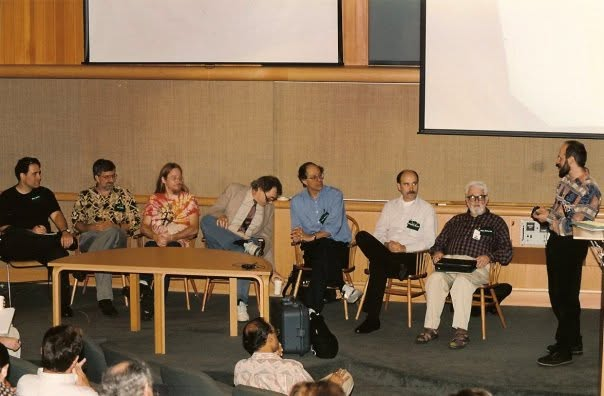

# Ken Kahn 🎈🐦🌀

Invitation portrayal — **not** Ken Kahn. [Standards](../../schemas/portrayal-standards.md)

Between 1973 and 1979, Ken taught artificial intelligence to elementary school
children as a graduate researcher in the MIT AI Lab's Logo Group. In 2026 he is
still teaching AI to children, fifty-three years later.

| | |
|---|---|
| 1973–79 | Taught AI to elementary schoolers, MIT AI Lab Logo Group, with Papert |
| 1979 | PhD thesis *Creation of Computer Animation from Story Descriptions*; advisor Carl Hewitt, with Minsky and Papert as readers; generated animated films from loosely specified stories |
| 1990–91 | Pictorial Janus, a visual form of a distributed concurrent constraint language |
| 1993 | NPUC, IBM Almaden: *Sketches and Animations as Programs*, as Animated Programs, Inc. |
| 1995– | ToonTalk: programming as a video-game city, with robots trained by demonstration and messages carried by birds to nests |
| 2017– | eCraft2Learn AI blocks for Snap!: speech, ML, pattern recognition and LLMs in a browser |
| 2023 | Snap!Con Barcelona: led the LLM-integration session, including [orchestrating conversations between characters](https://www.youtube.com/watch?v=d2rNGsbzkXI) |
| 2026 | *The Learner's Apprentice: AI and the Amplification of Human Creativity*; chatbot-collaboration experiments |

[Career summary and sources](sources/hn-2026-09-career-summary.md).

Recently he has been publishing documented chatbot-collaboration experiments. One is
[a machine-written history of two AI myths](https://toontalk.github.io/misc/ai-history-two-claims.html),
which he edited, passing drafts between Claude and ChatGPT
([making-of here](https://docs.google.com/document/d/1SuekouRgA8NrQMOJdmpfowesV4-qTQxmhOe54aTYyw8/edit)).
The models talked each other out of about half a dozen overclaims, and neither could
draw the *Perceptrons* cover spirals until one explained to the other where the
ambiguity has to go.

*Ted Selker's NPUC workshop, IBM Almaden: Marc Davis, Ken Kahn, Don
Hopkins (in the Terrapin Station tie-dye), Fred Lakin, Danny Bobrow, Tim
Brown, John McCarthy, Ted Selker.
[Notes on the disputed date of the photo](sources/npuc-almaden-panel.md).*

**Start here:** [Invitation](invitation.md) ·
[Interview hooks](ideas.md) ·
[Career summary, 1973–2026](sources/hn-2026-09-career-summary.md) ·
[The 2026 experiments](sources/2026-chatbot-experiments.md) ·
[CS547 / Gosling / ToonTalk (2023)](sources/2023-02-stanford-cs547-gosling-toontalk/README.md) ·
[Show seed](../../repo-shows/ken-kahn/README.md)

Verifiable sources in `CHARACTER.yml`. Subject may request correction or removal anytime.
