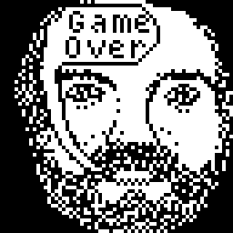
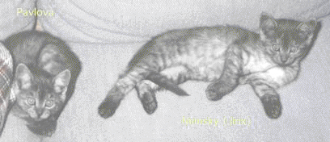

# Mark Weiser 🕯️

*In memoriam (1952–1999).* Memorial portrayal — **not** Mark Weiser. [Memorial mode](../../schemas/portrayal-standards.md#memorial-mode)

**Field:** Ubiquitous computing, calm technology — Xerox PARC CTO; co-author of Don's CHI'88 pie-menu paper

[Tribute](memorial.md)

**Memorial mode:** we represent and *discuss* him — never interview or speak as him. He was a **co-author of the CHI'88 pie-menu paper** (Callahan, Hopkins, Weiser, Shneiderman), so [Don](../don-hopkins/README.md) and [Ben Shneiderman](../ben-shneiderman/README.md) can remember him directly on air. Also: drummer for **Severe Tire Damage**, the first band to play live on the Internet ([its merchandise and music, recovered](media/severe-tire-damage/README.md)).

**Sources (in this room):** [`sources/1991-03-mark-weiser-pie-menu-tape-stylus.md`](sources/1991-03-mark-weiser-pie-menu-tape-stylus.md) — 1991 demo tape, alphabetic pies, stylus.

**Software (in this room):** [`software/`](software/README.md) — **SDI**, his 1987 SunView missile
game, full recovered source: the blizzard pie menus (`piemenu_track.c` — "I used the snow to hack
pies into sunview," 24 Jan 1987), the hour-by-hour `HISTORY.nr` dev diary, and the self-revealing
source-code pie menu. Resurrection challenge issued to [Antoni Sawicki](../antoni-sawicki/README.md).

**Media (in this room):** [`media/`](media/) — the SDI icons as PNGs, including
[**talkingmark**](media/talkingmark.yml), Mark's bearded self-portrait that tells you "Game Over,"
his "mdw"-signed [game icon](media/sdi-icon-mdw.yml), the skyline with
[m·a·r·k hidden in the buildings](media/sdi-city-icon-mark.yml), and a
[contact sheet of all 55](media/sdi-icons-contact-sheet.png).

## His home pages, from the Wayback Machine

**Nijinsky and Pavlova (1995).** On 11 January 1995 Mark put up a page for the kittens he and
[Vicky Reich](../vicky-reich/README.md) shared, nearly identical twins, one male and one female, with
a puzzle: "The first picture is solved for you. Can you tell who is who in each of the others?" The
page and its four photographs are cached here:
[media/ubiq-kittens-1995](media/ubiq-kittens-1995/README.md). David Rosenthal used it in 2016 to show
what emulation adds to web archiving, viewing it in NCSA Mosaic as it first looked
([talk](https://blog.dshr.org/2016/07/talk-at-jisccni-workshop.html)).

**His home page (1999 capture).** In his own words there, he ran the Computer Science Laboratory at
Xerox PARC for seven years, stepped down in 1994 to found a startup, and in August 1996 became PARC's
Chief Technologist ("This will really be fun!"). He listed his research as garbage collection,
operating systems, user interfaces and ubiquitous computing; was program chair of the 15th Symposium
on Operating Systems Principles; organized the first workshop for heads of industrial computer
science laboratories for the Computing Research Association; and posted slides for his ICSE 97
keynote, "Software Engineering and People." Original HTML:
[weiser-home-1999.html](media/ubiq-kittens-1995/weiser-home-1999.html) ·
[the capture](https://web.archive.org/web/19990117032359/http://www.ubiq.com/hypertext/weiser/weiser.html).

Verifiable sources in `CHARACTER.yml`.
