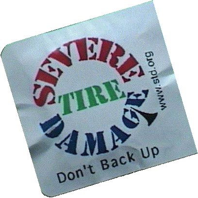
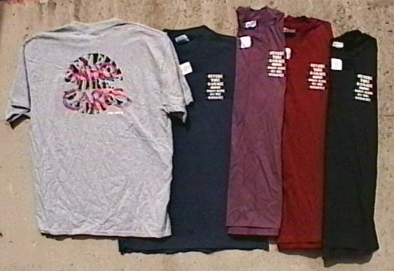
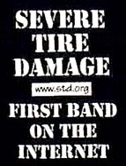
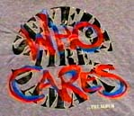
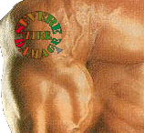
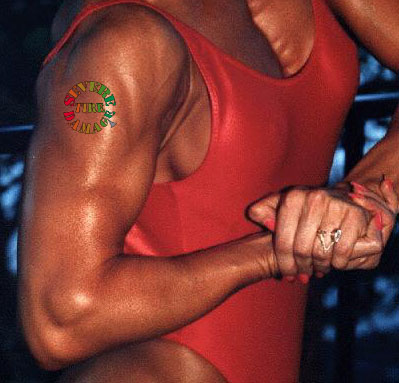
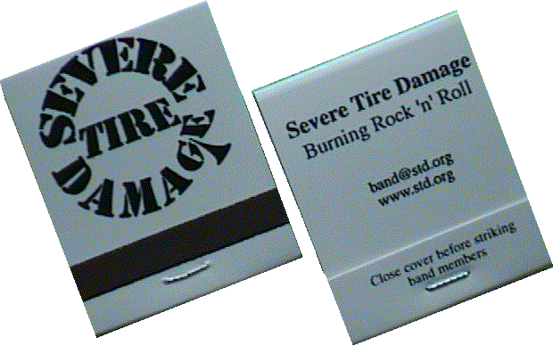

# Severe Tire Damage merchandise (1998–99)

The band's "Buy Stuff" pages, with their images, cached on 25 October 2026 from Wayback Machine
captures of `www.std.org` made between December 1998 and August 1999, byte for byte as the server
sent them. The band sold everything from its own site: matches at 10 cents, tattoos at 50 cents,
condoms at a dollar, T-shirts at $20, and CDs at $12 for the standard album or $15 plus 50 cents a
cut for a custom one.

## Condoms

> This fine product is hand made by Buhrundi Monks in secret underground laboratories. They come in
> many colors and flavors and may even inhibit conception when used correctly. The condoms will,
> too. "Don't Back Up" is just one of the catchy slogans on each condom package. Collect the whole
> set. Trade them with friends.

## T-shirts

> These "Hanes Beefy Ts" come in any size, so long as it's Large or Extra Large; and any color, so
> long as it's Slate, Navy, Maroon, Purple, or Black. [...] While wearing the shirt, band members
> have been stopped on the street by passersby who recognize STD as "first band on the Net",
> without necessarily recognizing the person wearing it... If the wearer's response is, "STD
> SUCKS!" --it's probably a band member.

## The album

> You pick not just the songs, but the mix! Maybe you'd rather hear Mark sing instead of Steve. No
> problem! Maybe you like acoustic guitar. No problem! Maybe you'd rather hear wacky sound effects
> instead of drums. No problem! Listen to the songs on-line before making your decision. Order your
> custom album via the web!

The order page listed 39 cuts, from "Around and Around" to "Windy Flute Song," including alternate
versions such as "Time Marches On (Mark)" and "Who Cares (Steve)," streamed as RealAudio
([buystuff.html](pages/buystuff.html)). The recordings themselves are in [the music](../README.md).

## Tattoos

 

> Accentuate your favorite body part with this keen STD Tattoo. [...] Although the official STD
> Tattoo is removable, Severe Tire Damage will contribute five dollars and a stencil towards any
> permanent application of an STD Tattoo. This offer void for Lemmy and children under twelve.

## Matchbooks

> Just the thing for when the skies of November turn chilly. Light your own fire or someone else's
> with these. Made entirely from non-replaceable clear-cut old growth by an ugly bald guy named Sid
> who likes to be called "Red."

## Files

| File | From |
|------|------|
| [`pages/`](pages/) | The original HTML: home (Jan 1999), high bandwidth home (Feb 1999), buy stuff, condom, T-shirt, album, tattoo (Dec 1998), matches (Aug 1999) |
| `condom.gif`, `shirts.jpg`, `shirts_sm.jpg`, `shirtfront_sm.jpg`, `shirtback_sm.jpg`, `cdcover.gif`, `tempTattoo.jpg`, `tempTattooS.gif`, `matches.gif` | `std.org/images/`, 1999 captures |
| `std.gif`, `iconfancy.gif`, `iconjukebox.gif`, `iconsimple.gif`, `iconhome.gif`, `buystuff.gif` | The site's banner and navigation icons |
| `std-round-logo-pasted.png` | The round tire-tread logo, from a copy Don pasted; its original file on std.org isn't yet located |

The band and Mark's family may ask for any of this to be changed or removed.

↑ [Severe Tire Damage](../README.md) · [Mark Weiser](../../../README.md)
