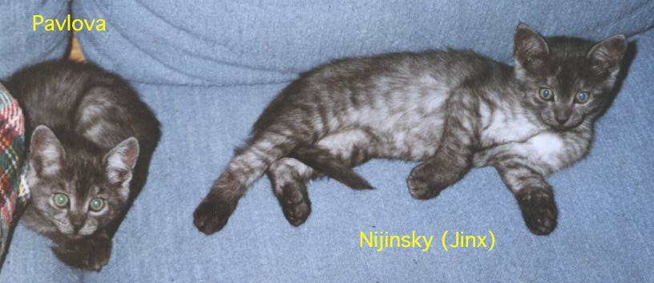
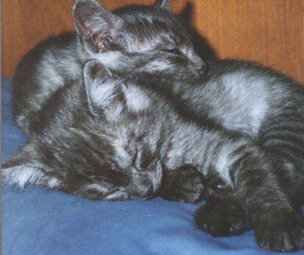
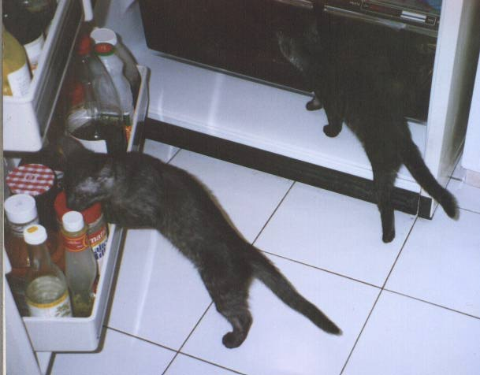
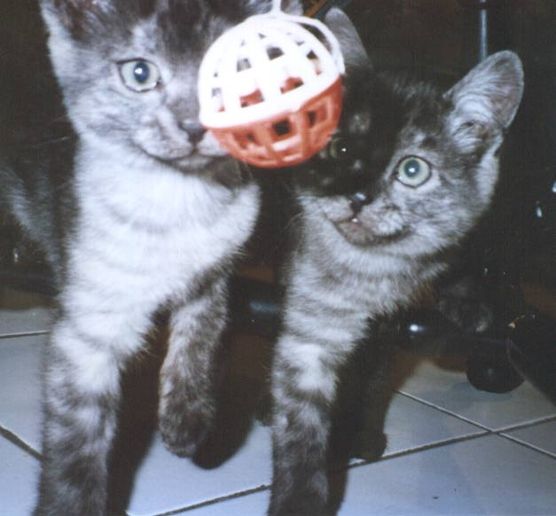

# Nijinsky and Pavlova (1995)

Mark Weiser's web page for the kittens he and Vicky Reich shared, put up on 11 January 1995 at
`www.ubiq.com/hypertext/weiser/Kitten.html`, one of the early cat pages on the Web. These are cached
copies of the page and its photographs, taken on 25 October 2026 from the Wayback Machine's
[1 December 1998 capture](https://web.archive.org/web/19981201080657/http://www.ubiq.com/hypertext/weiser/Kitten.html)
(39 captures, 1998–2008), byte for byte as the server sent them.

> **Nijinksy and Pavlova**
>
> Jinx and Pav are nearly identical twins, but male and female. The first picture is solved for
> you. Can you tell who is who in each of the others? (It *is* possible, given the clues given
> here, both behavioral and appearance.)
>
> — page by Mark Weiser, January 11, 1995 (his heading spells it "Nijinksy")

*The first picture, solved: Pavlova and Nijinsky (Jinx).*

The page linked to Mark's home page, to Vicky's at HighWire Press, and to "the Ultimate Cat Links
page." In 2016 David Rosenthal used it to show what emulation adds to web archiving: the Wayback
Machine keeps the text, images and links, but viewed in NCSA Mosaic through Ilya Kreymer's
oldweb.today, it looks the way it did when Mark put it up
([the talk](https://blog.dshr.org/2016/07/talk-at-jisccni-workshop.html)).

## Files

| File | What |
|------|------|
| [`Kitten.html`](Kitten.html) | The page, original HTML (`HTMLPLUS`) |
| [`KittenIdentification.jpeg`](KittenIdentification.jpeg) · [`KittenIdentificationSmall.gif`](KittenIdentificationSmall.gif) | The labelled photo, full size and thumbnail |
| [`KittensSleeping.jpeg`](KittensSleeping.jpeg) · [`KittensSleepingTiny.gif`](KittensSleepingTiny.gif) | Asleep |
| [`KittensInFridge.jpeg`](KittensInFridge.jpeg) · [`KittensInFridgeTiny.gif`](KittensInFridgeTiny.gif) | In the refrigerator |
| [`KittensWithBall.jpeg`](KittensWithBall.jpeg) · [`KittensWithBallTiny.gif`](KittensWithBallTiny.gif) | With a ball |
| [`weiser-home-1999.html`](weiser-home-1999.html) | Mark's home page, original HTML, from the [17 January 1999 capture](https://web.archive.org/web/19990117032359/http://www.ubiq.com/hypertext/weiser/weiser.html). Its photograph of Mark is by Peter Menzel, used there with permission, and is not copied here |

Mark published these on his own page. Vicky Reich and Mark's family may ask for any of it to be
changed or removed.

↑ [Mark Weiser](../../README.md) · [memorial](../../memorial.md)
